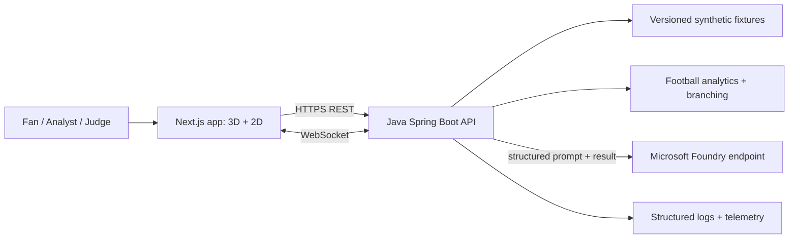

# 02 — System architecture (C4-oriented)

## Architectural principles
A **modular monolith** (Java Spring Boot) is better than fragile hackathon microservices. All football decisions happen server-side. Rendering remains a pure projection of canonical data. The AI layer explains computed facts; it cannot alter them.

## Context diagram

## Container deployment plan
- Web: Next.js container (Node LTS; server-side rendering optional, never store model keys in browser).
- API: single Java 21 Spring Boot 4.x container; WebSocket, `/api/v1` and Actuator; modular packages, stateless pure computations.
- Azure Container Apps: separate web/API apps in one environment, external HTTPS ingress for frontend and optionally API, explicit CORS origins and secure `wss://`; no request-level API secrets in browser.
- Model inference: Microsoft Foundry deployment endpoint through Java adapter. Secret via Key Vault/managed identity for deploy; local `.env` not committed.
- Storage phase 0: versioned JSON fixture resources built into the API; events/snapshots never mutable. No separate database is required for the judge demo. Post-hackathon stores can implement repository interface.

## Modules and ownership
| Module | Responsibility | Must NOT do |
|---|---|---|
| `match.domain` | immutable team/player/event/clock types | HTTP, graphics or provider-specific types |
| `match.fixture` | fixture ingestion, schema/reference validation, versioning | random score updates |
| `match.playback` | cursor, ordering, snapshot lookup and deterministic replay | authoritative ticking per-browser globally |
| `football.analytics` | named features, evidence graphs and detectors | natural-language imagination |
| `football.counterfactual` | branch validation, deterministic interventions, branch simulation | mutate original |
| `ai.application` | tool graph, role handoffs, grounded output validation | decide physical results or silently fabricate |
| `ai.provider` | Foundry/OpenAI-compatible adapter + fallback implementation | unbounded retries |
| `api.rest` | HTTP controllers/OpenAPI semantics | business logic |
| `api.ws` | realtime transport and reconnection | sole truth for replay state |
| `web.match` | timeline / interaction / view model | recompute authoritative metrics |
| `web.pitch` | 3D/2D projection of player state | create synthetic events while rendering |

## Canonical flow
1. `FixtureRepository` loads immutable fixture with schemaVersion, scenarioVersion, seed.
2. Fixture validator checks monotonic times per period, referential integrity, legal coordinates, score-event consistency, and key-moment snapshots.
3. `GET /matches/{id}`, `/timeline` and `/snapshots` serve baseline; user initiates playback with **client-local** wall-clock animation keyed to `matchClockMs` (not a global backend clock).
4. WebSocket transport may broadcast ticks/events for 'Live simulated mode', but a deterministic REST replay always works even if WS fails.
5. At a key moment, analytics calculates features + evidence (snapshot positions + events). An insight has immutable `insightId` and `algorithmVersion`.
6. AI orchestrator receives only validated fact cards, returns a structured narrative candidate; validator enforces metrics/source references. Fallback template is available.
7. User chooses a branching action; CounterfactualService creates branch from snapshot + seed, runs bounded rollout, preserves original, returns trajectories and coarse outcomes.
8. Frontend renders original and branch from separate state stores, never normalizing both into one mutable event array.

## Clock ownership and session isolation
- Source of truth: `matchClockMs` in persisted fixture and replay seek position; game clock is not Date.now().
- Default replay: user-local deterministic clock; no need for server sessions at MVP scale.
- 'Live simulated' optional: server sends signed monotonically increasing `seq` per session; reconnect catches up using `afterSeq` and snapshot reconciliation; gap triggers HTTP resync.
- Rendering interpolation is frame-rate independent: position = interpolate(snapshot A, snapshot B, alpha derived from `matchClockMs`), not integrate physics with unstable frame delta.
- Halftime and stoppage: use period + periodClockMs + matchClockMs; don't naively assume 45:00 equals exactly first-half ending.

## Data patterns
Immutable records; versioned JSON schemas; predictable event ordering by `(matchClockMs, seq)`; `BigDecimal` if currency ever appears, double for geometry with finite checks; all external DTOs validation annotations. Prefer records and sealed interfaces where useful; mapper code explicit.

## Failure modes and protections
- Foundry timeout: circuit-break, show validated template. Core replay and X-Ray unaffected.
- Missing tracking: hide unsupported space/runs claims, downgrade insight to event-only explanation.
- WebSocket disconnect: REST snapshot fetch, local replay continues and shows reconnected state.
- Unsupported WebGL: 2D SVG fallback, same controls and evidence inspector.
- Malformed fixture: fail app startup in strict production profile or quarantine fixture on load.
- Duplicate/stale WS packets: discard `seq <= lastProcessedSeq`, detect scenarioVersion mismatch -> full reload.

## Later scale-out (explicitly P2)
Move fixture repository to object storage + cache; replay API remains stateless; if shared broadcaster sessions become necessary, use external pub/sub and sticky-free reconnect protocol. Test it before adding Redis. Durable branches/PostgreSQL only when user accounts or long-lived experiments exist.

## Dependency and version policy
Java 21 LTS; Spring Boot 4.1.1 stable at design date; Spring AI 2.0.1 supports Boot 4.0/4.1; versions pinned and reconciled via Maven dependency management, `mvn dependency:tree`, and a green integration smoke test. Frontend major versions lockfile pinned (R3F v9 with React 19, do not use R3F v10 alpha by default). Do NOT claim arbitrary SDK method signatures; check official docs at implementation time.
